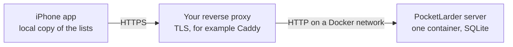

<div align="center">

<picture>
  <source media="(prefers-color-scheme: dark)" srcset="ios/PocketLarder/Assets.xcassets/Logo.imageset/logo-dark.svg">
  
</picture>

# PocketLarder

*Self-hosted shopping lists for one household*

[](https://github.com/vrob01/PocketLarder/releases)
[](ios/)
[](server/LICENSE)
[](ios/LICENSE)

[Features](#features) • [Getting started](#getting-started) • [Running the server](#running-the-server) • [Using the app](#using-the-app) • [Development](#development) • [Resources](#resources)

</div>

PocketLarder keeps a household's shopping lists on a server the household runs itself, with an iPhone app to fill and shop them. It does one job, shopping lists, and leaves recipes, meal planning and pantry tracking to other tools.

## Features

- **Sorted by store and category**, in the order you walk the store

- **Personal and shared lists** in one view

- **Always shows which list** you're adding to

- **Autocomplete** from the household's shared catalog

- **Private lists:** open, read-only or hidden

- **Works offline**, syncs later

- **Rows or tiles**, light or dark

- **No passwords:** sign in with an invite link or QR code

- **One container** with SQLite, behind your reverse proxy

- **No analytics, no tracking**



## Getting started

### Prerequisites

- **A Linux server with Docker Compose.** The image `ghcr.io/vrob01/pocketlarder` exists for linux/amd64 and linux/arm64.
- **A domain and a reverse proxy that handles TLS.** The examples use Caddy in a container.
- **An iPhone with iOS 27**, and a **Mac with Xcode 27** to install the app.

### 1. Run the server

Make an empty directory for the install and download the deployment files of a server release into it, no clone needed. Set `version` to the latest server release from the [releases page](https://github.com/vrob01/PocketLarder/releases):

```bash
version=<latest server release, for example 1.2.3>
for f in compose.yaml .env.example Caddyfile; do
  curl -fsSO "https://raw.githubusercontent.com/vrob01/PocketLarder/refs/tags/server/v$version/server/deploy/$f"
done
```

Run every later command from that directory.

1. **Configure.** Create your settings file with `cp .env.example .env`, then edit it:

   | Setting | Value |
   | --- | --- |
   | `POCKETLARDER_PUBLIC_URL` | Your own `https://` address, the same host as the Caddy site below |
   | `POCKETLARDER_HOST_DATA_DIR` | The host directory that holds the database, outside the install directory. The example uses `/srv/pocketlarder`. |
   | `POCKETLARDER_PROXY_NETWORK` | The Docker network PocketLarder shares with the reverse proxy |
   | `POCKETLARDER_VERSION` | The server release you run |

   Settings that depend on your deployment live only in `.env`, never in `compose.yaml`.

2. **Create the data directory.** It is bind-mounted at `/data` and must belong to the container user, 65532:65532:

   ```bash
   sudo mkdir -m 700 /srv/pocketlarder
   sudo chown 65532:65532 /srv/pocketlarder
   ```

3. **Start the server.** Create the proxy network, with the name from `.env`, then pull the image and start it:

   ```bash
   docker network create pocketlarder
   docker compose up -d
   ```

4. **Put the reverse proxy in front.** PocketLarder publishes no port. Only containers on the proxy network reach it, so your other services can stay on networks of their own. Attach Caddy to that network in Caddy's compose file:

   ```yaml
   services:
     caddy:
       networks: [pocketlarder]
   networks:
     pocketlarder:
       external: true
   ```

   Then add this site, as in the downloaded `Caddyfile`, with your domain in place of `lists.example.com`:

   ```
   lists.example.com {
   	encode zstd gzip
   	reverse_proxy pocketlarder:8080
   }
   ```

5. **Create the first admin.** This prints an invite link for the admin. Treat it as a secret (see [Invites are secrets](#invites-are-secrets)):

   ```bash
   docker compose exec pocketlarder pocketlarder invite --new-admin <name>
   ```

### 2. Install the app

1. Copy `ios/Config/Local.xcconfig.example` to `ios/Config/Local.xcconfig`, and set your Apple developer team and a bundle ID of your own.
2. Open `ios/PocketLarder.xcodeproj` in Xcode, pick your iPhone and run the `PocketLarder` scheme.

> [!NOTE]
> With a free Apple ID, the app stops opening after 7 days. Install it again from Xcode.

> [!TIP]
> No server needed to look around: "Try with sample data" on the welcome screen opens a sample household that stays on the iPhone and is deleted on Leave.

> [!IMPORTANT]
> Update the server before installing the app. An older server answers a request that lost its `Authorization` header with `unauthorized`, which makes the app sign out and delete its data.

### 3. Sign in

Open the invite link on the iPhone, from a message or the QR code, or enter it by hand under "Enter invite". From there, the admin invites the rest of the household in the app.

## Running the server

### Back up

```bash
docker compose exec pocketlarder pocketlarder backup /data/backup-$(date +%F).db
```

`backup` writes a 0600 file and refuses a path that already exists. Back up into a private directory such as `/data`, and use a fresh name for each run: a second backup on the same day needs a different name. Scheduling backups, and copying them off the server, is the host's job.

> [!WARNING]
> Restoring an older backup, or starting the server on an empty data directory (for example a data disk that didn't mount), signs out every phone the database doesn't know. Those phones delete their local copy and unsent changes, and each of them needs a new invite. Check the data directory before starting the server.

### Upgrade

1. Read the release notes of the new version on the [releases page](https://github.com/vrob01/PocketLarder/releases).
2. Set the new version in `POCKETLARDER_VERSION` in `.env`.
3. Pull the image and restart:

   ```bash
   docker compose pull
   docker compose up -d
   ```

The server migrates its database on start and refuses a database newer than itself, so going back to an older version after an upgrade that migrated doesn't work.

To check which version runs, use `docker compose exec pocketlarder pocketlarder version`, which prints, for example, `pocketlarder 1.0.0`. The app asks the server for its version too: when the server is too old for the app, the app says so and syncs nothing until the server is updated.

### Invites are secrets

An unredeemed invite signs in as its member, and `invite` prints it to stdout.

**Use `docker compose exec`.** Its output reaches only your terminal.

**Avoid `docker compose run`.** It hands stdout to the logging driver, with or without `--rm`:

| Logging driver | Invite ends up in | Removed by `--rm` |
| --- | --- | --- |
| `json-file`, `local` (default) | `docker logs`, `/var/lib/docker/containers/` | Yes, otherwise `docker rm` the container |
| `journald`, `syslog` | The host journal or syslog | No |
| `fluentd`, `gelf`, `awslogs`, … | The remote log server | No |

If you use it anyway: `docker compose run --rm pocketlarder invite <name>` (the entrypoint is `pocketlarder`).

**Revoke a logged invite**, or it stays valid for 24 hours. Admins with a paired device can use `POST /v1/invites/revoke` instead ([API](server/API.md)).

```bash
docker compose exec pocketlarder pocketlarder invite --revoke <name>
```

**Re-invite a signed-out member** with `pocketlarder invite <name>`. Their lists and data stay.

> [!CAUTION]
> Whoever reads the logs while an invite is outstanding and redeems it first becomes that member, in the worst case the first admin.

### Behind a reverse proxy

**Listen address.** `POCKETLARDER_LISTEN` defaults to `:8080`, plain HTTP on all interfaces. The compose container is reachable only from the proxy network. On a bare host, set `127.0.0.1:<port>`.

**No redirects.** The app refuses all redirects, so its token can't follow one to another host. Serve PocketLarder directly at `POCKETLARDER_PUBLIC_URL`: a redirect there (bare domain to `www`, an SSO login page) fails every request. `reverse_proxy` forwards, which is fine.

**Client addresses.** Invite redemption is rate-limited per client address. `POCKETLARDER_TRUST_PROXY=true` counts the last `X-Forwarded-For` entry instead of the connection's address. It's off by default and accepts `true`, `false` or empty; `serve` refuses anything else. The shipped `compose.yaml` sets it, and a bare host behind a proxy needs it too.

Turn it on only if both hold:

- nothing but the proxy reaches the server, and
- the proxy sets or appends `X-Forwarded-For` itself. Caddy's `reverse_proxy` does by default; nginx needs `proxy_set_header X-Forwarded-For $proxy_add_x_forwarded_for;`.

| Setup | Effect on the limit |
| --- | --- |
| Off behind a proxy | All clients share the proxy's address and one budget, so anyone can block pairing for everyone. Accept that or rate-limit in the proxy. |
| Proxy passes the client's header through | Clients pick the address they're counted under: they block pairing for any address, or spread attempts over many. |
| Something reaches the server directly (a container on the proxy network, a local process, a published port) | It can set the header and block pairing for any address. |
| Chain of proxies, such as a CDN in front of Caddy | Clients behind the same last hop share one budget. |

### File permissions

- `serve` creates the data directory 0700 and the database files 0600 only when they don't exist yet. An existing data directory or database keeps its current mode, so if you bring existing data along, check that the directory is 0700, the database files are 0600, and the owner is 65532:65532 in the container.
- The data directory is owned by uid 65532 on the host, so any host account with that uid can read the database.

## Using the app

- **Add another iPhone of yours:** My account > Add a device…, then scan the QR code with the new iPhone's Camera.
- **Manage your invites:** My account > Invites lists your invites, cancels open ones and clears used and expired ones. Admins find a member's invites on the member's page under Members & devices.
- **Run the household (admins):** My account > Members & devices invites new members, adds a device for a member, signs out devices and removes members.
- **Change the language:** the app follows the iPhone's language. To use another one, open Settings > Apps > PocketLarder > Language; My account > Language opens that page.

What the app and the server store, send and delete is in [PRIVACY.md](PRIVACY.md).

## Development

| Directory | Contents |
| --- | --- |
| `server/` | The Go server and its deployment files |
| `ios/` | The SwiftUI app and `PocketLarderKit`, its models, API client and sync |
| `docs/` | Design specs, mockups and implementation plans |
| `factory/` | The agent pipeline that builds GitHub issues into pull requests |

The server needs Go 1.24 or newer; `server/go.mod` pins a newer toolchain, which `go` downloads on first use. Xcode builds run on GitHub Actions, and the kit tests also run in Docker, without Xcode:

```bash
docker run --rm --user "$(id -u):$(id -g)" -e HOME=/tmp -v "$PWD/ios/PocketLarderKit:/pkg" -w /pkg swift:6.4.2-noble swift test
```

`bash factory/checks.sh` runs the server's checks, the kit and contract tests when a branch touches `ios/` or `server/`, and waits for the GitHub Xcode build when it touches `ios/` (`FACTORY_SKIP_CI=1` skips the wait). To build the server image from a clone and run it, with your settings in `server/deploy/.env`:

```bash
docker build -t ghcr.io/vrob01/pocketlarder:dev server && POCKETLARDER_VERSION=dev docker compose -f server/deploy/compose.yaml up -d
```

The `dev` tag means a local build never takes the tag of a published release. [AGENTS.md](AGENTS.md) covers running a dev server, versioning and releases.

## Resources

- [server/API.md](server/API.md): the server's HTTP API
- [PRIVACY.md](PRIVACY.md): privacy policy, in English and German
- [Product design](docs/superpowers/specs/2026-10-27-pocketlarder-design.md) and [iOS app design](docs/superpowers/specs/2026-10-30-pocketlarder-ios-design.md)
- [Releases](https://github.com/vrob01/PocketLarder/releases)
